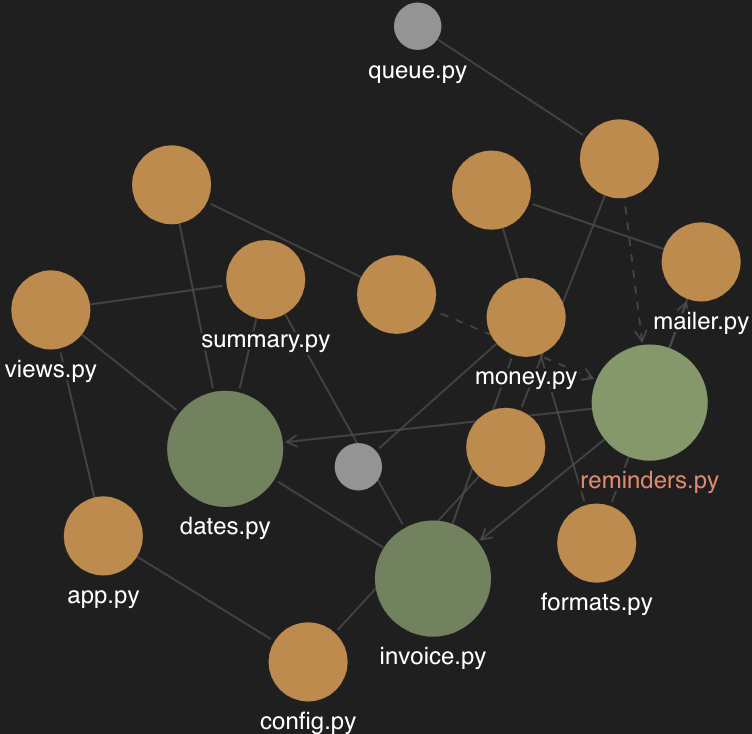

## Explore a code graph

The App image includes Code Graph. In repository settings, turn on **Code graph** and save to start indexing. The sync service runs the graph worker and starts an isolated parser for extraction.

After indexing, open the repository's **Code graph** page to explore file dependencies at the indexed revision. Search for a file, focus its neighborhood, and follow an import to the indexed source. The graph describes imports at that commit.

Refreshes retry after GitHub rate limits or temporary server errors. If indexing still fails, check **Code graph** in repository settings for the cause and recovery steps.

An MCP client with the Code read scope can inspect files and definitions at the requested revision when a matching index is ready. To compare two indexed commits, ask your agent to use the `trace-change-impact` guide with both commit SHAs. Enable the Code tool group and authorize the repository in the [MCP setup guide](/docs/app/mcp-and-api/#connect-scripts-and-agents).

The optional diagram on a PR overview groups changes for that pull request. Code Mortis can use related source as PR review context when a matching index is ready. Pull request diffs in **Code** are available independently of indexing. If you back up the graph, keep its `code-graph-data` volume with the matching PostgreSQL backup.
