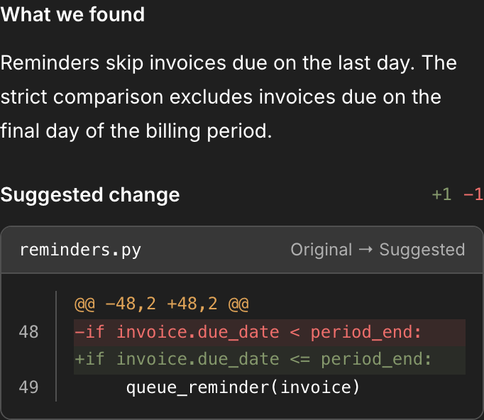

## Review a pull request

Open a pull request and choose **Run review**. Use **Findings** to inspect evidence or resolve and dismiss findings, **Code** to browse the diff, and **Overview** to read the GitHub description and any saved Mortis summary for that revision, including an interactive change diagram when available. **Run history** opens individual reviews, where **Coverage** shows which files were analyzed, reused, or skipped. A finding absent from a later review stays open until it is resolved or dismissed.

Code Mortis posts inline comments through your GitHub App and reports run status in a GitHub check. Inspect the run when the check reports incomplete coverage or a publication failure.

To review new commits on open, non-draft pull requests, turn on **Automatically review new commits** in repository settings. Fork pull requests require a manual start. Enable **Incremental automatic reviews** to reuse validated coverage for unchanged files when a compatible earlier review exists. The Coverage tab links to that review when it reuses coverage. Manual reviews and reviews using code graph context analyze all eligible files within the configured limits.

Use the repository's **Custom rules** page to add project-specific review instructions. Set file paths or globs to limit where a rule applies, or leave both empty to apply it to all files. The **Project context** and **Pull request reviews** sections of repository settings control shared exclusions, review sensitivity, and run limits.

### Follow a finding through the next commit

Open a finding to read its path, lines, evidence, and any proposed replacement. Resolve it, dismiss it with a reason, or reopen it from the drawer. When automatic resolution is enabled, Mortis verifies earlier evidence against the new PR head before resolving a linked GitHub thread. An uncertain result leaves the finding open.

If a review stops, open **Run history** and select the run. Depending on its state and your access, you can resume a blocked review, retry one failed assessment, or retry GitHub publication. If only publication failed, retry that step to publish the saved findings.
