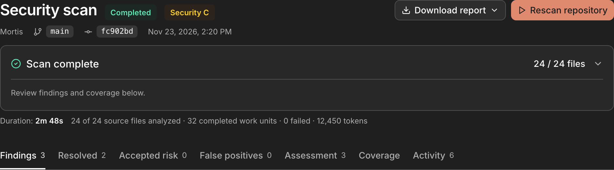
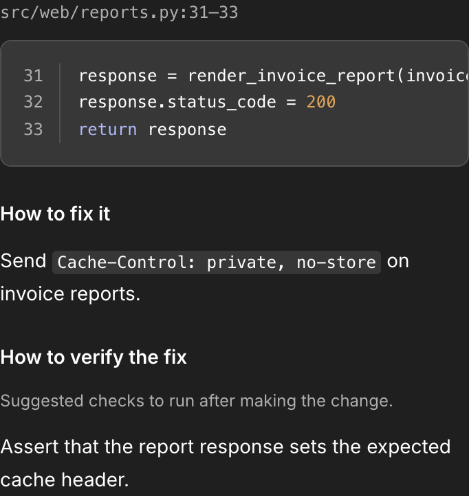

## Scan a repository

Open the repository's **Security** page and choose **Run scan**. Select a shared AI connection and start the scan. It analyzes a pinned commit from the default branch with Mortis Engine and runs Trivy checks for dependency vulnerabilities, exposed secrets, and infrastructure misconfigurations.

Inspect **Findings** to triage confirmed results or create GitHub issues for selected findings. Open **Scan history** to see each scan's coverage and assessment results. Read the saved grade alongside its commit, coverage, and any indication that the default branch has moved. Download the run’s Markdown or JSON report from its scan details.

Open a security finding to see its observations and remediation. You can mark a false positive, accept risk, or reopen it. For a reported secret, rotate or revoke the credential first, acknowledge the rotation in the drawer, and run a new scan so Mortis can verify removal. To hand a finding to a maintainer, preview the redacted GitHub issue draft before publishing. An eligible scan retry keeps the original limits and can reuse completed work.

